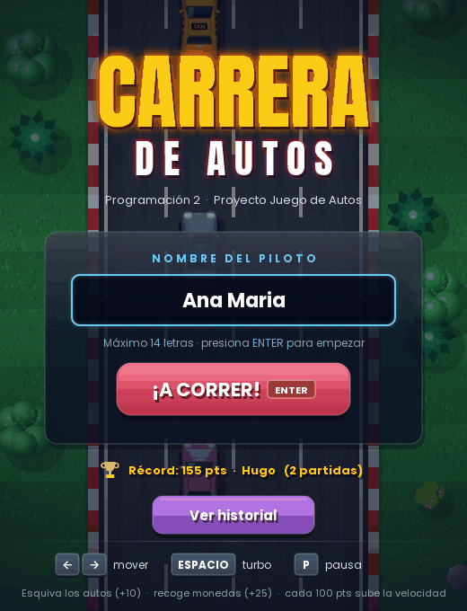
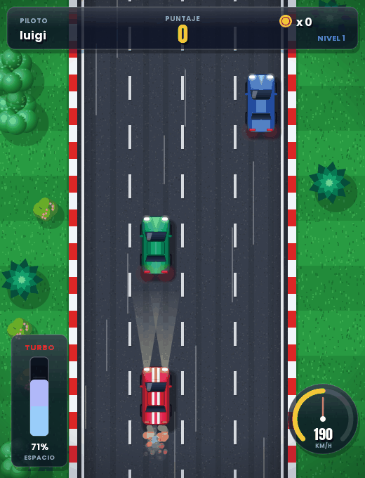
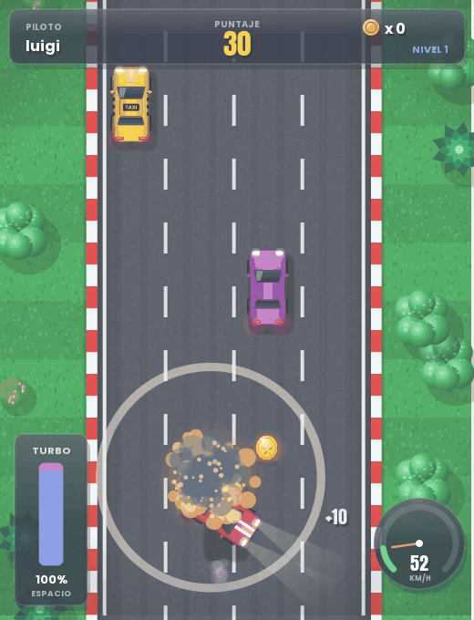
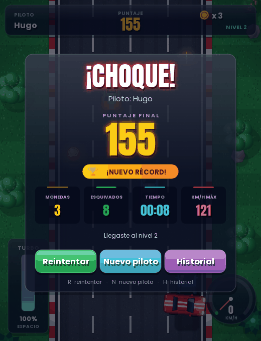
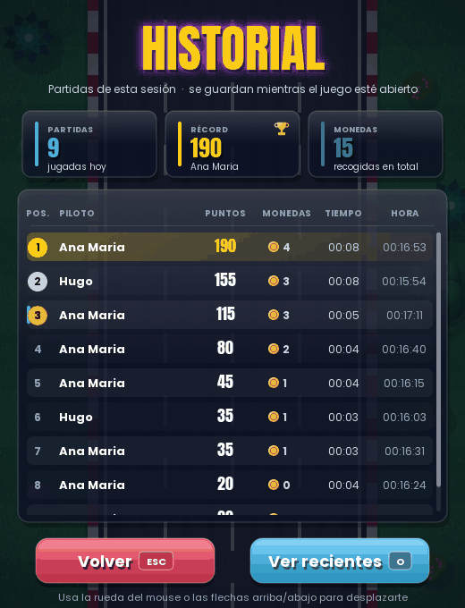
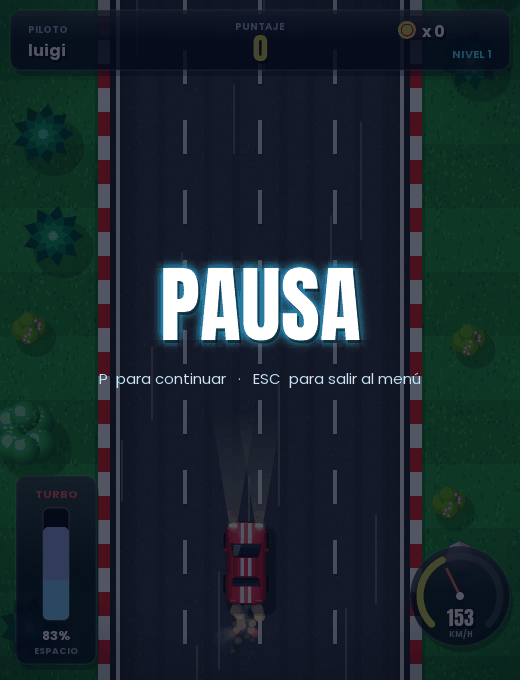
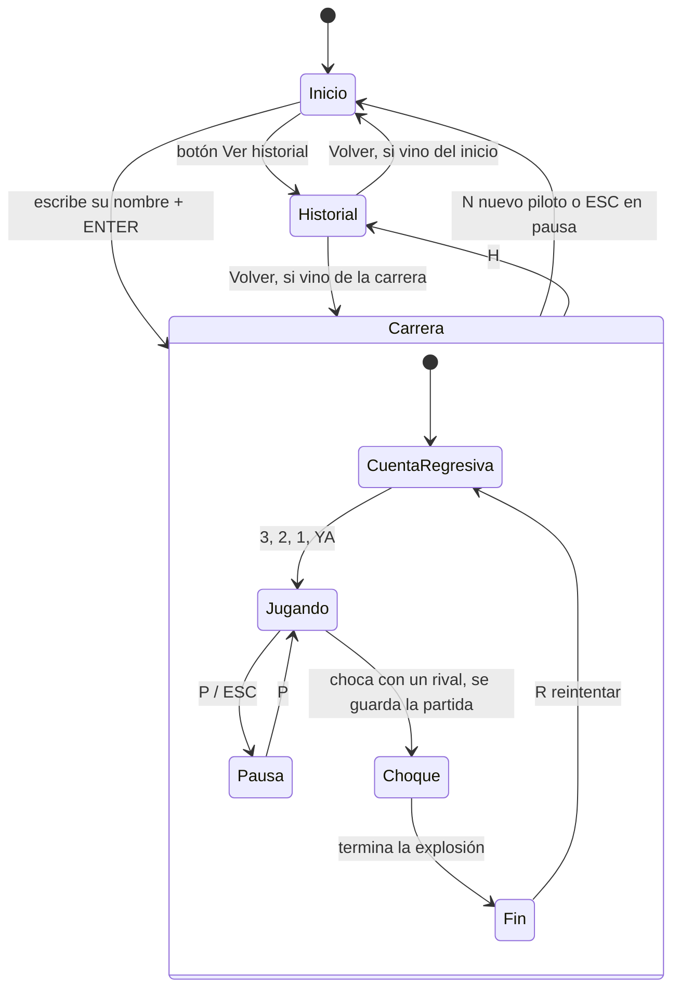
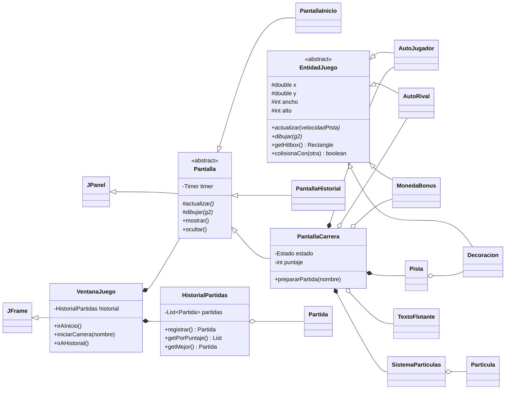

# 🏎️ Carrera de Autos: Proyecto de Programación 2

Juego de carreras visto desde arriba, hecho en **Java puro (Swing + Java2D)**, sin librerías externas.
El jugador escribe su nombre, esquiva el tráfico, recoge monedas, usa el turbo y, al chocar, su partida
queda guardada en un **historial** mientras el juego siga abierto.

| Inicio | Carrera | Choque |
|:---:|:---:|:---:|
|  |  |  |
| **Resultados** | **Historial / Ranking** | **Pausa** |
|  |  |  |

---

## 📑 Índice

1. [Cómo ejecutarlo](#️-cómo-ejecutarlo)
2. [Cómo se juega](#-cómo-se-juega)
3. [Qué tiene el juego](#-qué-tiene-el-juego)
4. [Estructura del proyecto](#️-estructura-del-proyecto)
5. [Flujo de pantallas](#-flujo-de-pantallas)
6. [Diagrama de clases](#-diagrama-de-clases)
7. [Cómo funciona por dentro](#️-cómo-funciona-por-dentro)
8. [Imágenes y fuentes](#️-imágenes-y-fuentes)
9. [Conceptos de POO aplicados](#-conceptos-de-poo-aplicados)
10. [Cómo cambiar cosas fácilmente](#️-cómo-cambiar-cosas-fácilmente)
11. [Cambios respecto a la versión anterior](#-cambios-respecto-a-la-versión-anterior)

---

## ▶️ Cómo ejecutarlo

### Desde IntelliJ IDEA (recomendado)

1. Abre la carpeta **`Paso3`** con *File → Open*.
2. Si IntelliJ lo pide, elige un JDK (*File → Project Structure → SDK*). Usa **JDK 11 o superior** (el juego funciona desde Java 8, pero una de las prácticas del proyecto necesita Java 11).
3. Abre `src/JuegoAutoProyecto/Main.java` y presiona el botón verde **▶ Run** al lado de `main`.

> Las imágenes y fuentes de `recursos/` se cargan solas: IntelliJ las copia al compilar.

### Desde la terminal

```bash
cd Paso3
javac -encoding UTF-8 -d out $(find src/JuegoAutoProyecto -name "*.java")
java -cp out JuegoAutoProyecto.Main
```

> Ejecuta el comando **desde la carpeta `Paso3`**: si los recursos no están en `out/`, el juego los busca en
> `src/JuegoAutoProyecto/recursos/`.

---

## 🎮 Cómo se juega

### Controles

| Tecla | Acción |
|---|---|
| `←` `→` o `A` `D` | Mover el auto a la izquierda / derecha |
| `ESPACIO` (mantener) | **Turbo**: más velocidad, gasta energía |
| `P` o `ESC` | Pausar / continuar |
| `ESC` (en pausa) | Salir al menú (la partida no se guarda) |
| `R` o `ENTER` (al chocar) | Reintentar con el mismo piloto |
| `N` (al chocar) | Nuevo piloto (vuelve a pedir el nombre) |
| `H` (al chocar) | Ver el historial |
| `O` (en el historial) | Cambiar entre *recientes* y *ranking* |
| Rueda del mouse o `↑` `↓` | Desplazar la tabla del historial |

También se puede hacer clic en todos los botones.

### Reglas

| Acción | Resultado |
|---|---|
| Esquivar (pasar) un auto rival | **+10** puntos |
| Recoger una moneda | **+25** puntos y **+20 %** de energía de turbo |
| Cada 100 puntos | Subes de **nivel**: la pista va más rápido y aparece más tráfico |
| Chocar con un rival | Fin de la partida, que se guarda en el historial |

El turbo se gasta mientras lo usas y se **recarga solo** cuando lo sueltas.

---

## ✨ Qué tiene el juego

- **Pide el nombre del jugador** antes de empezar. Si está vacío, la tarjeta tiembla y aparece un aviso en rojo.
  El último nombre usado se recuerda.
- **Cuenta regresiva animada** `3 · 2 · 1 · ¡YA!` con efecto de zoom.
- **Historial de partidas** mientras el juego está abierto: nombre, puntaje, monedas, rivales esquivados, nivel,
  velocidad máxima, duración y hora. Tiene resumen, ranking con medallas 🥇🥈🥉 y scroll.
  Cada partida también se imprime en la consola de IntelliJ.
- **Récords**: la pantalla de inicio muestra el récord actual y, si lo superas, aparece la insignia **¡NUEVO RÉCORD!**
- **Imágenes PNG** para todos los autos (jugador + 5 rivales, uno es taxi), la moneda, árboles, pinos, arbustos y rocas.
- **Animaciones y efectos**:
  - El auto acelera y frena suavemente y se **inclina** al girar.
  - Conos de luz de los faros, sombras bajo cada objeto y luces de freno que parpadean en los rivales.
  - Humo del escape, **llamas** y **líneas de velocidad** con el turbo.
  - Monedas que **giran**, brillan y sueltan **chispas** doradas al recogerlas, con texto flotante `+25`.
  - Choque con **explosión de partículas**, **onda expansiva**, destello blanco, **sacudida de pantalla** y el auto girando como trompo.
  - Tarjeta de resultados que **sube rebotando** y un puntaje que **cuenta hacia arriba**.
  - Escenario vivo: pasto con franjas, bordillos rojo/blanco, asfalto con textura y árboles que pasan.
- **HUD tipo vidrio**: piloto, puntaje (que "late" al subir), monedas, nivel, barra de turbo y **velocímetro** con aguja.
- **Pausa** en cualquier momento.

---

## 🗂️ Estructura del proyecto

```
JuegoAutoProyecto/
├── Main.java                  ← Punto de entrada: abre la ventana
│
├── pantallas/                 ← Lo que se ve en la ventana
│   ├── VentanaJuego.java      ← JFrame con CardLayout: cambia entre pantallas y guarda el historial
│   ├── Pantalla.java          ← Clase base abstracta: bucle de animación (Timer), teclado y mouse
│   ├── PantallaInicio.java    ← Pide el nombre del jugador
│   ├── PantallaCarrera.java   ← El juego en sí (máquina de estados, HUD, tarjeta final)
│   └── PantallaHistorial.java ← Tabla de partidas, resumen y ranking
│
├── entidades/                 ← Objetos que se mueven en la pista
│   ├── EntidadJuego.java      ← Clase base abstracta (posición, tamaño, colisión)
│   ├── AutoJugador.java       ← Auto del jugador (aceleración, inclinación, faros)
│   ├── AutoRival.java         ← Tráfico a esquivar
│   ├── MonedaBonus.java       ← Moneda giratoria
│   └── Decoracion.java        ← Árboles, pinos, arbustos y rocas (no chocan)
│
├── escenario/
│   └── Pista.java             ← Pasto, bordillos, asfalto, líneas, árboles y viñeta
│
├── efectos/                   ← Efectos visuales
│   ├── Particula.java         ← Un circulito que se mueve y se desvanece
│   ├── SistemaParticulas.java ← Humo, llamas, chispas y explosión
│   └── TextoFlotante.java     ← "+25", "+10", "¡NIVEL 3!"
│
├── historial/                 ← Guardado de partidas
│   ├── Partida.java           ← Datos de UNA partida (inmutable)
│   └── HistorialPartidas.java ← Lista de partidas en memoria, ranking y récord
│
├── util/                      ← Herramientas compartidas
│   ├── Config.java            ← Todas las constantes (tamaños, puntos, velocidades)
│   ├── Estilo.java            ← Colores, fuentes y funciones de dibujo reutilizables
│   ├── Recursos.java          ← Carga imágenes y fuentes (con caché)
│   └── Boton.java             ← Botón dibujado a mano con animación de hover
│
├── herramientas/
│   └── GeneradorRecursos.java ← (Opcional) Vuelve a dibujar las imágenes PNG
│
└── recursos/                  ← Imágenes PNG y fuentes TTF
```

---

## 🔄 Flujo de pantallas



---

## 🧱 Diagrama de clases



---

## ⚙️ Cómo funciona por dentro

### 1. El bucle del juego

Cada pantalla hereda de `Pantalla`, que tiene un `javax.swing.Timer` que se dispara **cada 16 ms (~60 FPS)**:

```
Timer (cada 16 ms) ──► actualizar()  →  mueve objetos, revisa choques, avanza animaciones
                   └─► repaint()     →  Swing llama a dibujar(g2) y se pinta el fotograma
```

El timer solo está encendido mientras la pantalla se ve (`mostrar()` / `ocultar()`), así no se gasta CPU de más.

### 2. La carrera es una máquina de estados

`PantallaCarrera` guarda un `enum Estado` y, en cada fotograma, hace algo distinto según el estado:

| Estado | Qué pasa |
|---|---|
| `CUENTA_REGRESIVA` | La pista rueda despacio y se muestran 3, 2, 1 |
| `JUGANDO` | Movimiento, tráfico, monedas, turbo, puntos y choques |
| `PAUSA` | No se actualiza nada |
| `CHOQUE` | Explosión, el mundo frena y el auto gira |
| `FIN` | Aparece la tarjeta de resultados con los botones |

### 3. La sensación de velocidad

El auto del jugador **casi no se mueve verticalmente**: lo que se mueve es el escenario. `Pista` guarda un
`desplazamiento` que crece con la velocidad, y con él corre hacia abajo las líneas, los bordillos, las texturas
y los árboles. Los rivales bajan al 80 % de la velocidad de la pista, como si fueran más lento que nosotros.

### 4. Tráfico justo

`generarTrafico()` crea rivales cada cierta distancia recorrida (a mayor nivel, más seguido). Antes de crear uno,
revisa qué carriles están ocupados arriba y **nunca bloquea los 4 carriles**: siempre queda un hueco por donde pasar.

### 5. Colisiones

Cada entidad tiene una *hitbox* (`getHitbox()`), un rectángulo apenas más chico que su dibujo.
`colisionaCon()` usa `Rectangle.intersects()` para saber si dos objetos se tocan.

### 6. Historial de partidas

- `VentanaJuego` crea **un solo** `HistorialPartidas` y lo comparte con todas las pantallas.
- Al chocar, `PantallaCarrera.guardarPartida()` llama a `historial.registrar(...)`, que crea una `Partida`
  y la agrega a un `ArrayList`.
- Antes de registrar se pregunta `esNuevoRecord(puntaje)` para mostrar la insignia de récord.
- El historial vive en memoria: **se mantiene mientras el juego está abierto** y se borra al cerrarlo.

### 7. Animaciones

| Efecto | Técnica |
|---|---|
| Aparecer con rebote | Curva `Estilo.easeOutBack(t)` aplicada a la posición |
| Moneda que gira | El ancho del dibujo es el valor absoluto de `cos(fase)` × ancho |
| Auto que se inclina | `g2.rotate(inclinacion)` con inclinación ∝ velocidad lateral |
| Humo, fuego, chispas | Cientos de `Particula` con velocidad, fricción, color y transparencia que cambian |
| Sacudida | `g2.translate()` con un desplazamiento aleatorio que se reduce cada fotograma |
| Brillo en títulos | El texto se dibuja varias veces desplazado y semitransparente |
| Fluidez | Texturas y viñeta se pre-dibujan una vez en `BufferedImage` |

---

## 🖼️ Imágenes y fuentes

Todo está en `recursos/`:

| Archivo | Uso |
|---|---|
| `auto_jugador.png` | Auto del jugador (también es el ícono de la ventana) |
| `rival_azul.png`, `rival_verde.png`, `rival_morado.png`, `rival_naranja.png`, `rival_taxi.png` | Tráfico |
| `moneda.png` | Moneda |
| `arbol.png`, `pino.png`, `arbusto.png`, `roca.png` | Decoración del costado |
| `Anton-Regular.ttf` | Fuente de títulos y números |
| `Poppins-Bold.ttf`, `Poppins-Regular.ttf` | Fuente de textos |

### ¿Quieres usar tus propias fotos?

Reemplaza el PNG por otro **con el mismo nombre**. Recomendaciones:

- Los autos deben verse **desde arriba**, con el **frente hacia arriba** y **fondo transparente**.
- Mejor si tienen proporción de **96 × 172 px** (el juego los dibuja a 48 × 86).
- Si falta una imagen, el juego **no se cae**: dibuja una figura de respaldo y avisa en la consola.

Las imágenes actuales se generaron con `herramientas/GeneradorRecursos.java`. Si quieres cambiar sus colores,
edita ese archivo y ejecútalo (▶). Las fuentes tienen licencia libre **SIL OFL** (ver `recursos/LICENCIA_FUENTES.txt`).

---

## 🧠 Conceptos de POO aplicados

| Concepto | Dónde se ve |
|---|---|
| **Herencia** | `AutoJugador`, `AutoRival`, `MonedaBonus` y `Decoracion` heredan de `EntidadJuego`. Las 3 pantallas heredan de `Pantalla`. |
| **Abstracción** | `EntidadJuego` y `Pantalla` son clases `abstract` con métodos abstractos (`actualizar`, `dibujar`). |
| **Polimorfismo** | Cada entidad implementa `dibujar()` a su manera y la pista/carrera las dibuja sin saber de qué tipo son. |
| **Encapsulamiento** | Atributos `private`/`protected` con *getters*. `Partida` es inmutable (todo `final`). `getPartidas()` devuelve una lista no modificable. |
| **Composición** | `VentanaJuego` *tiene* un historial y pantallas. `PantallaCarrera` *tiene* una pista, un jugador y un sistema de partículas. |
| **Enumeraciones** | `PantallaCarrera.Estado` (máquina de estados) y `Decoracion.Tipo`. |
| **Colecciones** | `ArrayList` + `Iterator` para borrar mientras se recorre. `Comparator` para el ranking. `HashMap` como caché en `Recursos`. |

---

## 🛠️ Cómo cambiar cosas fácilmente

Casi todo se ajusta en **`util/Config.java`**:

| Constante | Qué controla | Valor |
|---|---|---|
| `ANCHO`, `ALTO` | Tamaño de la ventana | 520 × 680 |
| `PUNTOS_POR_RIVAL` | Puntos por esquivar | 10 |
| `PUNTOS_POR_MONEDA` | Puntos por moneda | 25 |
| `PUNTOS_POR_NIVEL` | Cada cuántos puntos sube el nivel | 100 |
| `VELOCIDAD_INICIAL` | Velocidad al empezar | 6 |
| `AUMENTO_POR_NIVEL` | Velocidad extra por nivel | 0.7 |
| `EXTRA_TURBO` | Velocidad extra del turbo | 5 |
| `MAX_LETRAS_NOMBRE` | Largo máximo del nombre | 14 |

Los colores están en **`util/Estilo.java`**.

---

## 📋 Cambios respecto a la versión anterior

| Antes | Ahora |
|---|---|
| 7 clases en una sola carpeta | 22 clases ordenadas en 7 paquetes según lo que hacen |
| Arrancaba directo, sin nombre | Pantalla de inicio que **pide el nombre del jugador** |
| No guardaba nada | **Historial** de cada partida + ranking + récord |
| Figuras geométricas simples | **Imágenes PNG** de autos, monedas y escenario, y fuentes propias |
| Movimiento a saltos | Aceleración, inclinación, sombras, faros y partículas |
| "¡CHOQUE!" estático | Explosión, onda expansiva, sacudida y tarjeta de resultados animada |
| Turbo sin límite | Turbo con barra de energía que se gasta y se recarga |
| Imágenes opcionales con rutas que fallaban | `Recursos` las carga desde el classpath, con respaldo |
| Sin pausa | Pausa con `P` |
| Rivales que podían bloquear todos los carriles | Siempre queda un camino libre |
