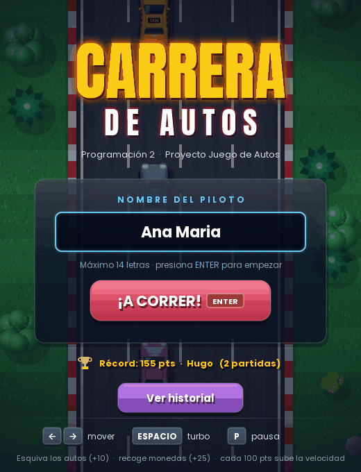
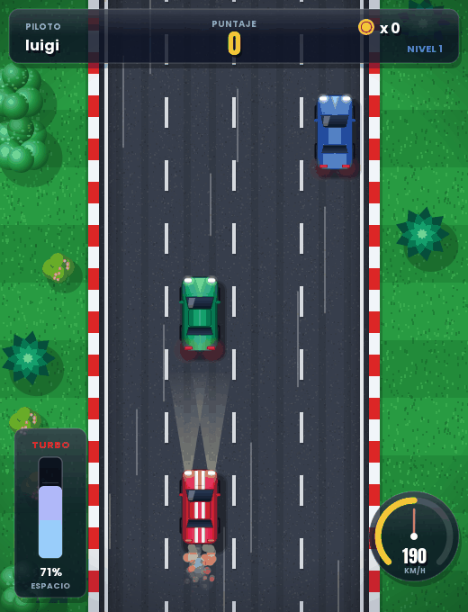
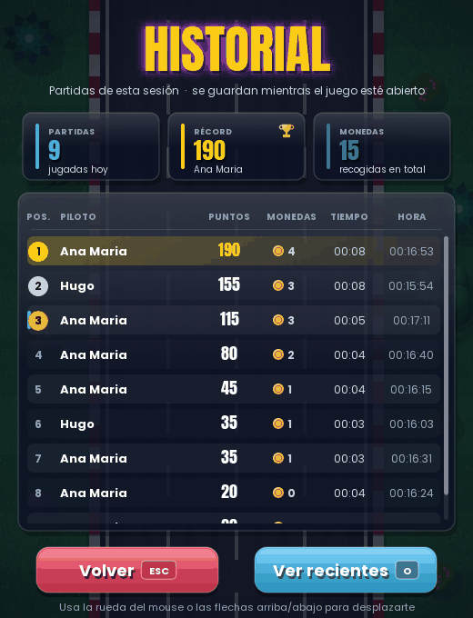

# JUEGO: Programación 2

Repositorio de la materia **Programación 2** (Java). La tarea principal es el juego
**[Carrera de Autos](Paso3/src/JuegoAutoProyecto/README.md)**. El resto de las carpetas son prácticas de clase.

<p align="center">
  
  
  
</p>

## 🚀 Ejecutar el juego en 30 segundos

1. En IntelliJ IDEA: **File → Open →** carpeta `Paso3`.
2. Abre `src/JuegoAutoProyecto/Main.java`.
3. Presiona **▶ Run**, escribe tu nombre y ¡a correr!

Toda la explicación del juego (controles, estructura, diagramas y cómo funciona) está en
**[`Paso3/src/JuegoAutoProyecto/README.md`](Paso3/src/JuegoAutoProyecto/README.md)**.

## 🗂️ Qué hay en el repositorio

```
JUEGO/
├── README.md                      ← Este archivo
├── docs/capturas/                 ← Capturas de pantalla del juego
└── Paso3/                         ← Proyecto de IntelliJ (Paso3.iml)
    └── src/
        ├── JuegoAutoProyecto/     ← 🏎️ TAREA: juego Carrera de Autos (con su propio README)
        │
        │   — Prácticas de clase (sin cambios) —
        ├── Proyecto1/             ← Primera versión del juego de autos, todo en un archivo
        ├── Tarea2/                ← Juego "Atrapa Frutas" (canasta que atrapa frutas)
        ├── Practica1/             ← Ventana de pedidos "Cafetería Doña Rosa" (formularios Swing)
        ├── app/ · modelo/ · vista/← Registro de estudiantes (patrón modelo–vista)
        └── Tarea/                 ← Registro de máquinas de una planta (en progreso)
```

| Carpeta | Qué es | Clase para ejecutar |
|---|---|---|
| `JuegoAutoProyecto` | **Juego Carrera de Autos (tarea)** | `JuegoAutoProyecto.Main` |
| `Proyecto1` | Versión anterior del juego | `Proyecto1.CarreraAutosJava` |
| `Tarea2` | Atrapa Frutas | `Tarea2.Main` |
| `Practica1` | Pedidos de cafetería | `Practica1.VentanaPedidos` |
| `app`, `modelo`, `vista` | Registro de estudiantes | `app.Main` |
| `Tarea` | Planta y máquinas (incompleta) | — |

## 🧰 Requisitos

- **JDK 11 o superior** para compilar todo el proyecto (la práctica `vista` usa `String.isBlank()`).
  El juego por sí solo funciona desde Java 8.
- IntelliJ IDEA (recomendado) o cualquier editor con `javac`.
- No usa librerías externas: solo Java estándar (Swing / Java2D).
